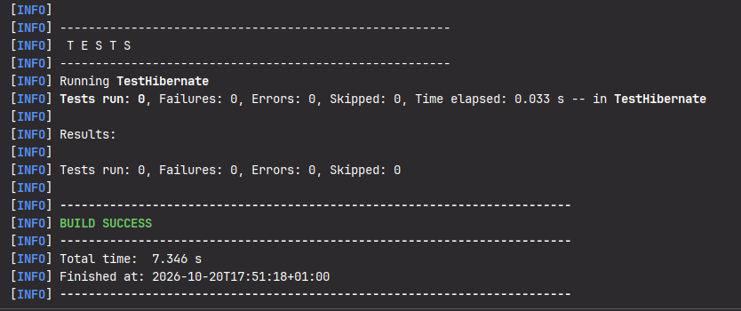
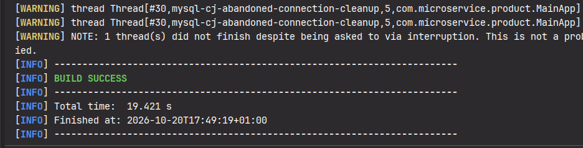
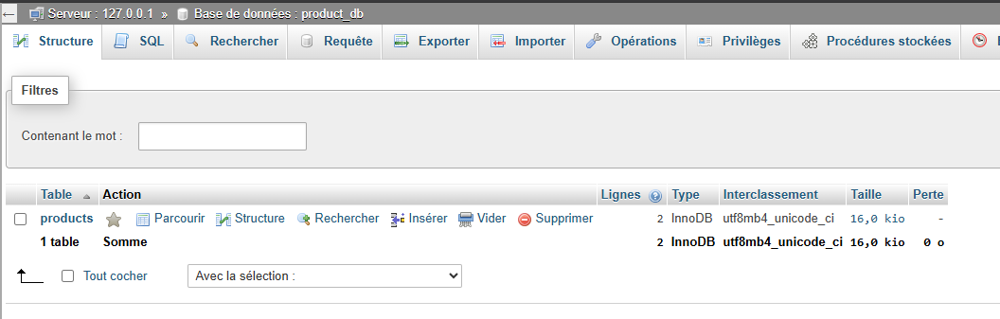
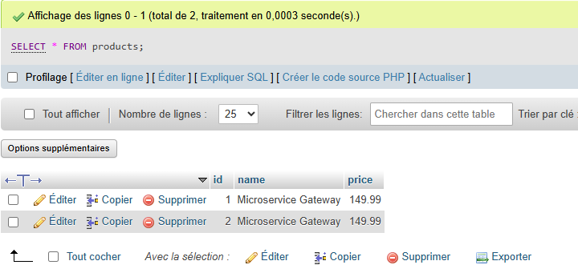

# Lab 4 - Microservice Product : Intégration Spring Framework & Hibernate avec Pattern DAO Générique

Ce projet illustre la conception et l'implémentation de la couche d'accès aux données et de la couche service d'un microservice de gestion de produits (**`microservice-product`**). Il combine la puissance de **Spring Framework (Context & ORM)** et d'**Hibernate ORM**, en appliquant les bonnes pratiques de conception logicielle telles que le **Pattern DAO Générique `<T>`** et la **gestion transactionnelle déclarative (`@Transactional`)**.

---

## Sommaire
- [Objectifs d'Apprentissage](#objectifs-dapprentissage)
- [Architecture & Conception](#architecture--conception)
- [Structure du Projet](#structure-du-projet)
- [Configuration Technique](#configuration-technique)
  - [Dépendances Maven (pom.xml)](#dépendances-maven-pomxml)
  - [Propriétés de Connexion (application.properties)](#propriétés-de-connexion-applicationproperties)
- [Composants Clés](#composants-clés)
  - [Modèle de Données JPA (`Product.java`)](#modèle-de-données-jpa-productjava)
  - [Pattern DAO Générique (`IDao<T>` et `ProductDaoImpl.java`)](#pattern-dao-générique-idaot-et-productdaoimpljava)
  - [Configuration Spring & Persistence](#configuration-spring--persistence)
  - [Couche Service & Transactions (`ProductServiceImpl.java`)](#couche-service--transactions-productserviceimpljava)
- [Extraits de Résultats & Captures d'Écran](#extraits-de-résultats--captures-décran)
  - [1. Test de Démarrage Spring & Hibernate (`TestHibernate`)](#1-test-de-démarrage-spring--hibernate-testhibernate)
  - [2. Exécution du Scénario Métier (`MainApp`)](#2-exécution-du-scénario-métier-mainapp)
  - [3. Structure de la Table Générée dans MySQL / phpMyAdmin](#3-structure-de-la-table-générée-dans-mysql--phpmyadmin)
  - [4. Consultation des Données Persistées dans phpMyAdmin](#4-consultation-des-données-persistées-dans-phpmyadmin)
- [Guide d'Exécution](#guide-dexécution)

---

## Objectifs d'Apprentissage

- Structuration modulaire d'un microservice Java avec **Maven**.
- Mappage Objet-Relationnel (ORM) via les annotations **JPA** (`@Entity`, `@Table`, `@Id`, `@GeneratedValue`, `@Column`).
- Factorisation du code d'accès aux données grâce au **Pattern DAO Générique avec types paramétrés `<T>`**.
- Configuration du conteneur IoC Spring avec la classe d'usine `LocalSessionFactoryBean` et `DataSource`.
- Gestion déclarative et automatique des frontières de transactions avec `@Transactional` et `HibernateTransactionManager`.
- Validation unitaire et intégration avec une base de données relationnelle **MySQL / MariaDB (XAMPP)**.

---

## Architecture & Conception

Le projet adopte une architecture en couches étanche pour garantir la maintenabilité et la testabilité :

```
       +---------------------------------------------+
       |   Couche Présentation / Point d'Entrée      |
       |         (MainApp / TestHibernate)           |
       +---------------------------------------------+
                              |
                              v
       +---------------------------------------------+
       |               Couche Service                |
       |  (ProductService / ProductServiceImpl)      |  <-- @Transactional & Règles Métier
       +---------------------------------------------+
                              |
                              v
       +---------------------------------------------+
       |           Couche Accès aux Données          |
       |      (IDao<Product> / ProductDaoImpl)       |  <-- Pattern DAO Générique <T>
       +---------------------------------------------+
                              |
                              v
       +---------------------------------------------+
       |          Hibernate SessionFactory           |
       +---------------------------------------------+
                              |
                              v
       +---------------------------------------------+
       |         Base de Données MySQL / MariaDB     |
       |                 (product_db)                |
       +---------------------------------------------+
```

---

## Structure du Projet

```
TP4_LAB4/
├── pom.xml                                           # Configuration Maven & dépendances
├── README.md                                         # Documentation complète du laboratoire
├── screenshots/                                      # Captures d'écran des résultats
│   ├── 01-test-hibernate.png
│   ├── 02-main-app-execution.png
│   ├── 03-db-structure-phpmyadmin.png
│   └── 04-db-data-phpmyadmin.png
└── src/
    ├── Screenshot 2026-10-20 164941.png              # Fichiers originaux des captures
    ├── Screenshot 2026-10-20 165025.png
    ├── Screenshot 2026-10-20 165100.png
    ├── Screenshot 2026-10-20 165127.png
    └── main/
        ├── java/
        │   └── com/
        │       └── microservice/
        │           └── product/
        │               ├── MainApp.java              # Scénario d'exécution principal
        │               ├── TestHibernate.java        # Test de démarrage et connectivité
        │               ├── config/
        │               │   ├── AppConfig.java        # Balayage des composants Spring (@ComponentScan)
        │               │   ├── HibernateConfig.java  # Définition des beans DataSource & SessionFactory
        │               │   └── TransactionConfig.java# HibernateTransactionManager & @EnableTransactionManagement
        │               ├── dao/
        │               │   ├── IDao.java             # Interface DAO générique <T>
        │               │   └── ProductDaoImpl.java   # Implémentation concrète Hibernate pour Product
        │               ├── entity/
        │               │   └── Product.java          # Entité JPA persistée en table "products"
        │               └── service/
        │                   ├── ProductService.java   # Interface de service métier
        │                   └── ProductServiceImpl.java # Implémentation transactionnelle du service
        └── resources/
            └── application.properties                # Paramètres JDBC & dialecte Hibernate
```

---

## Configuration Technique

### Dépendances Maven (`pom.xml`)

```xml
<properties>
    <maven.compiler.source>17</maven.compiler.source>
    <maven.compiler.target>17</maven.compiler.target>
    <project.build.sourceEncoding>UTF-8</project.build.sourceEncoding>
    <spring.version>5.3.20</spring.version>
    <hibernate.version>5.6.9.Final</hibernate.version>
    <mysql.version>8.0.33</mysql.version>
</properties>

<dependencies>
    <!-- Spring Context (IoC / DI) -->
    <dependency>
        <groupId>org.springframework</groupId>
        <artifactId>spring-context</artifactId>
        <version>${spring.version}</version>
    </dependency>

    <!-- Spring ORM (Intégration Hibernate & Gestion de Transactions) -->
    <dependency>
        <groupId>org.springframework</groupId>
        <artifactId>spring-orm</artifactId>
        <version>${spring.version}</version>
    </dependency>

    <!-- Hibernate Core (ORM JPA Provider) -->
    <dependency>
        <groupId>org.hibernate</groupId>
        <artifactId>hibernate-core</artifactId>
        <version>${hibernate.version}</version>
    </dependency>

    <!-- Pilote JDBC MySQL -->
    <dependency>
        <groupId>com.mysql</groupId>
        <artifactId>mysql-connector-j</artifactId>
        <version>${mysql.version}</version>
    </dependency>
</dependencies>
```

### Propriétés de Connexion (`application.properties`)

Situé dans `src/main/resources/application.properties` :

```properties
jdbc.driver=com.mysql.cj.jdbc.Driver
jdbc.url=jdbc:mysql://localhost:3306/product_db?useSSL=false&serverTimezone=UTC
jdbc.username=root
jdbc.password=secret

hibernate.dialect=org.hibernate.dialect.MySQL8Dialect
hibernate.show_sql=true
hibernate.hbm2ddl.auto=update
```

> **Note :** Le paramètre `hibernate.hbm2ddl.auto=update` permet à Hibernate de créer ou mettre à jour automatiquement le schéma relationnel de la base de données au démarrage sans supprimer les données existantes.

---

## Composants Clés

### Modèle de Données JPA (`Product.java`)

```java
package com.microservice.product.entity;

import javax.persistence.*;

@Entity
@Table(name = "products")
public class Product {

    @Id
    @GeneratedValue(strategy = GenerationType.IDENTITY)
    private Long id;

    @Column(nullable = false)
    private String name;

    @Column(nullable = false)
    private double price;

    public Product() {}

    public Product(String name, double price) {
        this.name = name;
        this.price = price;
    }

    // Getters et Setters
    public Long getId() { return id; }
    public void setId(Long id) { this.id = id; }
    public String getName() { return name; }
    public void setName(String name) { this.name = name; }
    public double getPrice() { return price; }
    public void setPrice(double price) { this.price = price; }
}
```

### Pattern DAO Générique (`IDao<T>` et `ProductDaoImpl.java`)

L'interface générique `IDao<T>` abstrait les opérations CRUD pour n'importe quelle entité :

```java
package com.microservice.product.dao;

import java.util.List;

public interface IDao<T> {
    void save(T entity);
    void update(T entity);
    void delete(T entity);
    T findById(Long id);
    List<T> findAll();
}
```

L'implémentation concrète `ProductDaoImpl` injecte la `SessionFactory` d'Hibernate et interagit directement avec la session active :

```java
@Repository
public class ProductDaoImpl implements IDao<Product> {

    @Autowired
    private SessionFactory sessionFactory;

    @Override
    public void save(Product product) {
        sessionFactory.getCurrentSession().save(product);
    }

    @Override
    public void update(Product product) {
        sessionFactory.getCurrentSession().update(product);
    }

    @Override
    public void delete(Product product) {
        sessionFactory.getCurrentSession().delete(product);
    }

    @Override
    public Product findById(Long id) {
        return sessionFactory.getCurrentSession().get(Product.class, id);
    }

    @Override
    public List<Product> findAll() {
        return sessionFactory.getCurrentSession().createQuery("FROM Product", Product.class).list();
    }
}
```

### Configuration Spring & Persistence

- **`HibernateConfig.java`** : Initialise la source de données JDBC (`DriverManagerDataSource`) et configure la fabrique de sessions Hibernate (`LocalSessionFactoryBean`) en scannant les entités dans `com.microservice.product.entity`.
- **`TransactionConfig.java`** : Configure le `HibernateTransactionManager` et active la gestion déclarative avec `@EnableTransactionManagement(proxyTargetClass = true)`.
- **`AppConfig.java`** : Active le composant de découverte automatique avec `@ComponentScan(basePackages = "com.microservice.product")`.

### Couche Service & Transactions (`ProductServiceImpl.java`)

La couche service isole la logique métier (validation des prix positifs) et délimite les transactions via `@Transactional` :

```java
@Service
public class ProductServiceImpl implements ProductService {

    @Autowired
    private IDao<Product> productDao;

    @Override
    @Transactional
    public void addProduct(Product product) {
        if (product.getPrice() < 0) {
            throw new IllegalArgumentException("Le prix ne peut pas être négatif");
        }
        productDao.save(product);
    }

    @Override
    @Transactional(readOnly = true)
    public List<Product> getAllProducts() {
        return productDao.findAll();
    }
}
```

---

## Extraits de Résultats & Captures d'Écran

Les résultats des exécutions et la persistance en base de données sont illustrés ci-dessous (fichiers originaux situés dans `src/` et dupliqués dans `screenshots/`).

### 1. Test de Démarrage Spring & Hibernate (`TestHibernate`)

Vérification de l'initialisation du conteneur Spring, de la création de la `SessionFactory` et de la validation de connexion avec la base de données `product_db`.


*(Fichier source : `src/Screenshot 2026-10-20 165127.png`)*

**Extrait des logs console :**
```text
[INFO] --- exec:3.6.4:java (default-cli) @ microservice-product ---
INFO: HHH000412: Hibernate ORM core version 5.6.9.Final
INFO: HHH000400: Using dialect: org.hibernate.dialect.MySQL8Dialect
Hibernate: create table products (id bigint not null auto_increment, name varchar(255) not null, price double precision not null, primary key (id)) engine=InnoDB
INFO: HHH000490: Using JtaPlatform implementation: [org.hibernate.engine.transaction.jta.platform.internal.NoJtaPlatform]
Contexte Spring initialisé avec succès !
[INFO] ------------------------------------------------------------------------
[INFO] BUILD SUCCESS
[INFO] Total time: 7.346 s
[INFO] ------------------------------------------------------------------------
```

---

### 2. Exécution du Scénario Métier (`MainApp`)

Exécution du scénario complet avec instanciation du service, enregistrement d'un nouveau produit via la transaction Spring, puis récupération et comptage en base.


*(Fichier source : `src/Screenshot 2026-10-20 164941.png`)*

**Extrait des logs console :**
```text
INFO: HHH000400: Using dialect: org.hibernate.dialect.MySQL8Dialect
Hibernate: insert into products (name, price) values (?, ?)
Hibernate: select product0_.id as id1_0_, product0_.name as name2_0_, product0_.price as price3_0_ from products product0_
Produit ajouté avec succès ! Total en base : 1
[INFO] ------------------------------------------------------------------------
[INFO] BUILD SUCCESS
[INFO] Total time: 19.421 s
[INFO] ------------------------------------------------------------------------
```

---

### 3. Structure de la Table Générée dans MySQL / phpMyAdmin

Hibernate a automatiquement généré la table relationnelle `products` avec les types de colonnes, clés et le moteur `InnoDB` appropriés grâce à `hibernate.hbm2ddl.auto=update`.


*(Fichier source : `src/Screenshot 2026-10-20 165025.png`)*

**Propriétés de la table :**
| Propriété | Valeur |
|---|---|
| **Base de données** | `product_db` |
| **Nom de la table** | `products` |
| **Moteur de stockage** | `InnoDB` |
| **Interclassement** | `utf8mb4_unicode_ci` |
| **Nombre d'enregistrements** | 2 |
| **Taille** | 16,0 Kio |

---

### 4. Consultation des Données Persistées dans phpMyAdmin

Affichage des enregistrements insérés dans la table `products` suite aux exécutions successives de `MainApp` :


*(Fichier source : `src/Screenshot 2026-10-20 165100.png`)*

**Résultat SQL (`SELECT * FROM products;`) :**

| id | name | price |
|---|---|---|
| **1** | `Microservice Gateway` | `149.99` |
| **2** | `Microservice Gateway` | `149.99` |

---

## Guide d'Exécution

### Prérequis
- **JDK 17** (ou JDK 21 configuré en compatibilité 17)
- **Apache Maven 3.8+**
- **Serveur MySQL / MariaDB** (via XAMPP actif sur le port standard `3306`)

### Étape 1 : Préparation de la Base de Données
Assurez-vous que MySQL est démarré sur XAMPP et que la base existe :
```sql
CREATE DATABASE IF NOT EXISTS product_db CHARACTER SET utf8mb4 COLLATE utf8mb4_unicode_ci;
```

### Étape 2 : Compilation du Projet
```bash
mvn clean compile
```

### Étape 3 : Exécution du Test d'Initialisation Hibernate
```bash
mvn exec:java "-Dexec.mainClass=com.microservice.product.TestHibernate"
```

### Étape 4 : Exécution de l'Application Principale
```bash
mvn exec:java "-Dexec.mainClass=com.microservice.product.MainApp"
```
